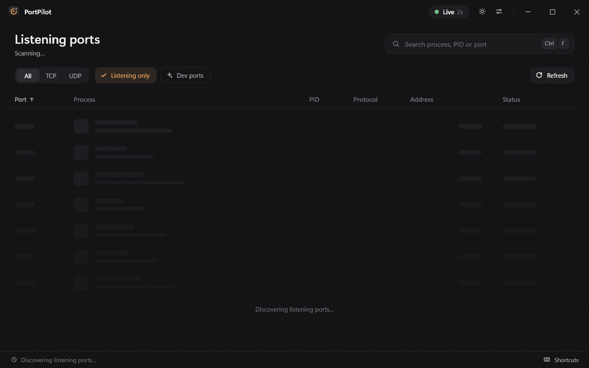

The first release. PortPilot shows every listening port on your Windows machine, which process owns it, and lets you open, copy, reveal or terminate it.



## Download

| File | For |
| --- | --- |
| **`PortPilot-1.0.0-Setup.exe`** (~44 MB) | Most people. Installs for your user only, no admin prompt, adds a Start menu entry, uninstalls cleanly. |
| `PortPilot-1.0.0-portable.exe` (~64 MB) | No install. One file, runs from anywhere. Opens a little slower than the installed copy because it unpacks itself each time. |
| `SHA256SUMS.txt` | Checksums, if you like to check. |

Windows 10 (1809+) or Windows 11, x64. Nothing else to install — .NET is included.

### "Windows protected your PC"

You'll probably see this the first time. It appears for any app that isn't signed with a paid code-signing certificate and hasn't been downloaded many times yet. Click **More info → Run anyway**.

If you'd rather check first: these files were built by GitHub Actions from the tagged commit, and GitHub signed a provenance attestation for each one. With the GitHub CLI you can confirm the file you downloaded is exactly what this repository's workflow produced:

```powershell
gh attestation verify .\PortPilot-1.0.0-Setup.exe --repo Atrix21/port-pilot
```

Or compare against `SHA256SUMS.txt`:

```powershell
Get-FileHash .\PortPilot-1.0.0-Setup.exe -Algorithm SHA256
```

## What's in 1.0

- Live list of every listening TCP and UDP endpoint (IPv4 and IPv6), refreshed every 2 seconds, scans in ~3 ms
- Process name, icon, PID, path, full command line, start time, uptime and publisher
- Labels for ~35 common dev ports (Vite, Next.js, PostgreSQL, Redis…) and a dev-ports-only filter
- New ports are highlighted; closed ones fade out
- Open in browser, copy, show in Explorer, terminate (with confirmation and PID-reuse protection)
- Clear messaging when Windows requires administrator rights, with one-click elevated restart
- Light and dark themes, keyboard shortcuts for everything, tray mode, start with Windows
- No telemetry, no network calls, no accounts

Found a bug? [Open an issue](https://github.com/Atrix21/port-pilot/issues/new/choose).
