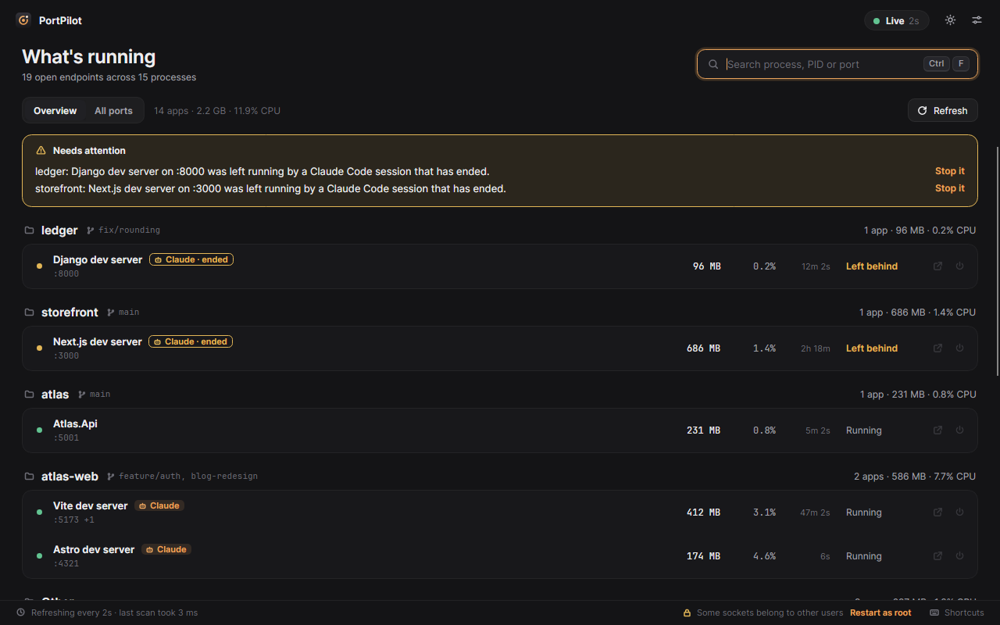

PortPilot now runs on **Linux and macOS** as well as Windows, and shows **apps, not ports**: what each project is running, with its CPU and memory.



## What's new since 1.0.0

- **Linux and macOS.** A native desktop app (with tray or menu-bar icon) and a ~3 MB terminal app, `portpilot`. No runtime to install.
- **Apps, not ports.** The overview groups a dev server with its workers into one row named the way you'd say it (*Vite dev server*, *Django dev server*, *npm run dev*), with memory and CPU for the whole family, totals per project, and a *Needs attention* list in plain sentences.
- **Projects and coding agents.** Ports are grouped by git project and branch, tagged with the agent that started them (Claude Code, Codex, Gemini CLI, Aider, …), and servers left running by an ended agent session are flagged, with one-click cleanup.
- **Health and logs.** See whether each dev server is actually answering, and its last lines of output.
- **For agents.** An MCP server (`portpilot mcp`), a Claude Code hook that cleans up after sessions, and a guard that stops an agent starting a second dev server on a busy port.
- **Editors.** VS Code / Cursor / Windsurf / VSCodium and JetBrains IDEs.

## Download

| Platform | File |
| --- | --- |
| **Windows** | `PortPilot-1.2.0-Setup.exe` (or the portable exe) |
| **Linux x64 / arm64** | `portpilot-linux-x64.tar.gz` / `portpilot-linux-arm64.tar.gz` |
| **macOS Apple silicon / Intel** | `PortPilot-osx-arm64.zip` / `PortPilot-osx-x64.zip`, or `brew install --cask portpilot` after `brew tap atrix21/port-pilot https://github.com/Atrix21/port-pilot` |
| **VS Code and forks** | `portpilot-<platform>.vsix`, or search *PortPilot* in the Marketplace / Open VSX |
| **JetBrains IDEs** | `portpilot-jetbrains-1.2.0.zip` |

On Linux:

```sh
curl -L https://github.com/Atrix21/port-pilot/releases/latest/download/portpilot-linux-x64.tar.gz | tar xz
./portpilot-linux-x64/install.sh
```

Every file has a build-provenance attestation: `gh attestation verify <file> --repo Atrix21/port-pilot`.
