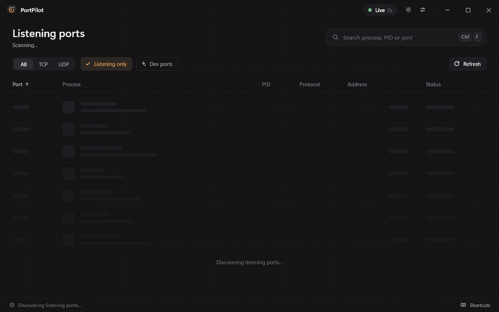
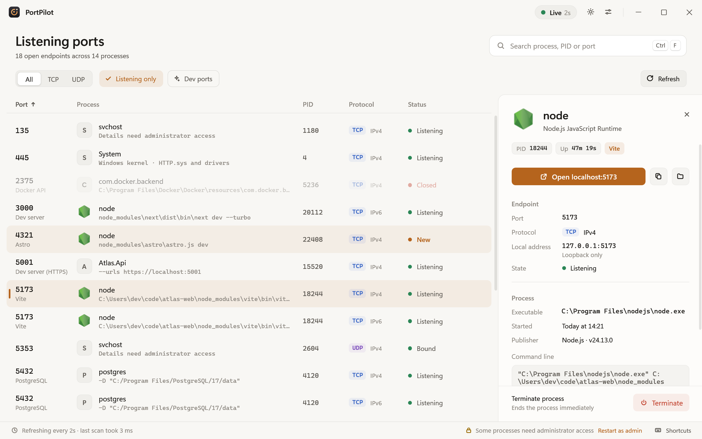
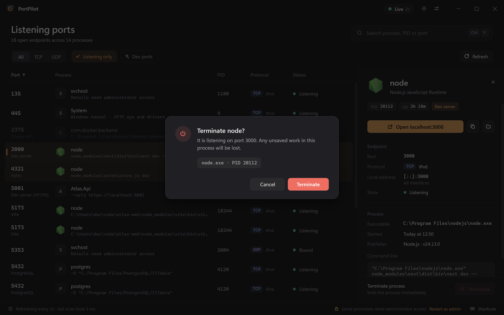
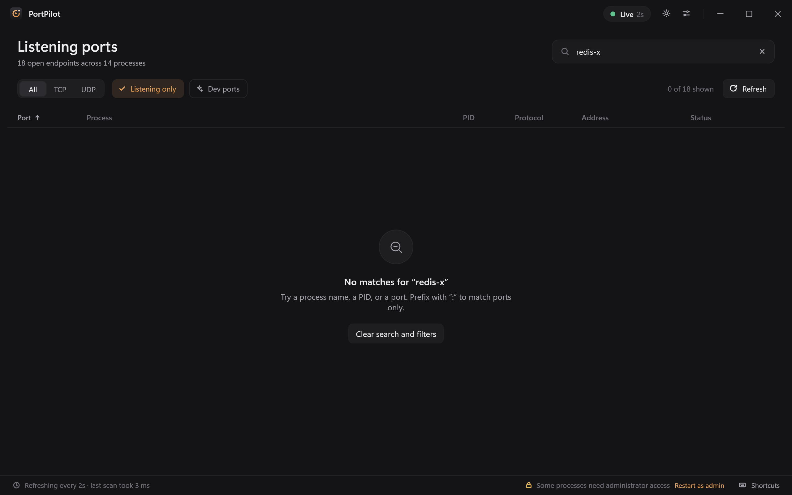
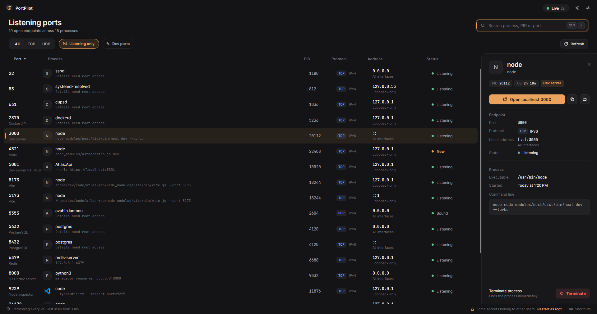
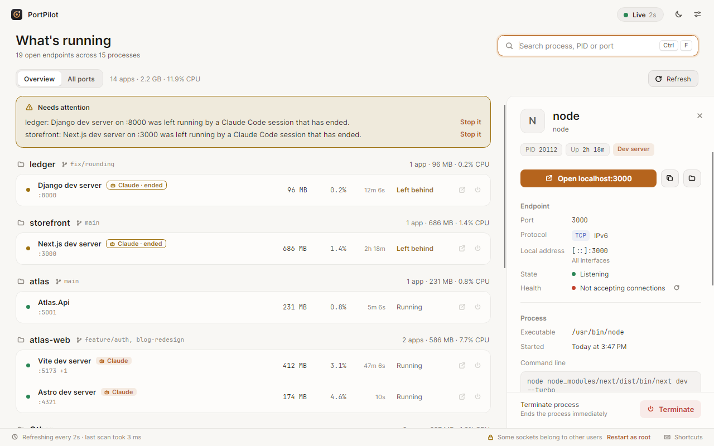

<p align="center">
  
</p>

<h1 align="center">PortPilot</h1>

<p align="center">
  <b>Something is already running on port 3000.</b><br/>
  It has always been running on port 3000. PortPilot tells you what it is, and lets you end it with dignity.
</p>

<p align="center">
  <a href="https://github.com/Atrix21/port-pilot/releases/latest"></a>
</p>

<p align="center">
  <a href="https://github.com/Atrix21/port-pilot/actions/workflows/ci.yml"></a>
  
  
  
  
  
  
</p>

<p align="center">
  
</p>

<p align="center"><sub>Real app, real timing, fake processes. No Next.js servers were harmed. One was terminated, but it asked for it.</sub></p>

---

## The problem

```text
Error: listen EADDRINUSE: address already in use :::3000
```

You did not start anything on port 3000. You are almost sure of this. You run `netstat -ano | findstr :3000`, which returns a PID and no explanation. You open Task Manager, which has 214 processes, 31 of which are called `node`. You pick one. It was Slack.

PortPilot is the window you open instead.

## What it does

PortPilot is a small native Windows app that watches every listening port on your machine and tells you, in plain language, who is responsible.

- **Every listening port, live.** TCP and UDP, IPv4 and IPv6, refreshed every two seconds. A full scan takes about 3 ms, which is less time than you have spent reading this sentence.
- **The actual culprit.** Process name, PID, real app icon, executable path, the full command line (so `node` becomes `vite --port 5173`), when it started, and who published it.
- **Knows your ports.** 3000, 5173, 8000, 8080, 5432, 6379 and about thirty others are labelled *Vite*, *PostgreSQL*, *Redis* and so on. One click hides everything else.
- **Notices change.** A server that just started glows briefly and says *New*. One that just died turns grey and says *Closed*, then quietly leaves. Your browser opens and closes a throwaway UDP socket every second or two; PortPilot has decided not to make that your problem.
- **Actions, with a seatbelt.** Open `localhost:5173` in your browser, copy details, show the executable in File Explorer, or terminate the process. Terminating asks first, and checks the PID still belongs to the same process before doing anything. It will not kill the System process, itself, or anything Windows considers critical, however politely you ask.
- **Honest about permissions.** Windows keeps some processes private unless you are an administrator. PortPilot says *Details need administrator access* rather than pretending they don't exist, and offers to restart elevated.
- **Lives in the tray.** Close the window and it keeps watching. Optionally it will tell you when a dev server starts, in case you forgot you started it.

<table>
  <tr>
    <td width="50%"></td>
    <td width="50%"></td>
  </tr>
  <tr>
    <td align="center"><sub>Click a row. Learn everything. Regret nothing.</sub></td>
    <td align="center"><sub>It asks first. Most tools don't.</sub></td>
  </tr>
  <tr>
    <td width="50%"></td>
    <td width="50%"></td>
  </tr>
  <tr>
    <td align="center"><sub>Settings apply immediately. There is no Save button to forget.</sub></td>
    <td align="center"><sub>Even the empty states were designed. Someone had to.</sub></td>
  </tr>
</table>

## Download

**[Get the latest release →](https://github.com/Atrix21/port-pilot/releases/latest)**

| File | For |
| --- | --- |
| `PortPilot-x.y.z-Setup.exe` (~44 MB) | Most people. Installs for your user only, no admin prompt, uninstalls cleanly. |
| `PortPilot-x.y.z-portable.exe` (~64 MB) | Commitment issues. One file, runs from anywhere, installs nothing. |

Windows 10 (1809+) or 11, x64. .NET is bundled, so there is nothing else to install.

**From a package manager**, if typing is your love language:

```powershell
scoop bucket add portpilot https://github.com/Atrix21/port-pilot
scoop install portpilot
```

`winget install Atrix21.PortPilot` is [submitted to Microsoft](https://github.com/microsoft/winget-pkgs/pull/486356) and waiting for review. It will work as soon as a human at Microsoft clicks a green button.

**About the blue "Windows protected your PC" box.** You'll probably see it. Windows shows it for any app that isn't signed with a paid certificate and hasn't been downloaded thousands of times yet. It is not a verdict on the app, just on its bank balance. Click **More info → Run anyway**. Every release is built by [GitHub Actions](https://github.com/Atrix21/port-pilot/actions/workflows/release.yml) straight from the tagged source, and GitHub signs a provenance attestation for each file. Trust, but verify: `gh attestation verify PortPilot-1.0.0-Setup.exe --repo Atrix21/port-pilot`.

Want to look around first? `PortPilot.exe --demo` runs it against a pretend developer machine, so you can click *Terminate* on things without consequences, which is more than can be said for real life.

### Or build it yourself

```powershell
git clone https://github.com/Atrix21/port-pilot.git
cd port-pilot
./build.ps1        # tests, then artifacts/publish/PortPilot.exe and artifacts/installer/*.exe
```

Needs the [.NET 10 SDK](https://dotnet.microsoft.com/download/dotnet/10.0) and [Inno Setup 6](https://jrsoftware.org/isinfo.php) (`winget install JRSoftware.InnoSetup`). It takes a couple of minutes, most of which is the installer compressing itself.

## On macOS

```sh
brew tap atrix21/port-pilot https://github.com/Atrix21/port-pilot
brew install --cask portpilot
```

You get `PortPilot.app`, a native build for Apple silicon or Intel, with `portpilot` on your `PATH`. Alternatively, download `PortPilot-x.y.z-osx-arm64.zip` (or `-osx-x64`) from the release and drag the app to Applications. It's the same app as on Linux, with the same projects, agents, health and logs, and it sits in the menu bar when its window is closed.

The engine uses `libproc`, the same API as `lsof` and Activity Monitor, so it needs no root. One difference from Linux: macOS doesn't let you see another user's sockets at all, so run `sudo portpilot` to include them. The app is ad-hoc signed but not notarised. The Homebrew cask clears the quarantine flag for you; if you downloaded the zip yourself, run `xattr -dr com.apple.quarantine /Applications/PortPilot.app` once.

## In your editor

| Editor | Install |
| --- | --- |
| **VS Code, Cursor, Windsurf, VSCodium** | `portpilot-<platform>.vsix` from the release (*Extensions → … → Install from VSIX*), or search *PortPilot* in the Marketplace or Open VSX (ID `Atrix21.portpilot-dev`) |
| **IntelliJ IDEA, WebStorm, PyCharm, GoLand, Rider, …** | `portpilot-jetbrains-x.y.z.zip` from the release (*Settings → Plugins → ⚙ → Install Plugin from Disk*) |

Both are thin layers over the same engine:

- **A Ports view** (VS Code) or **tool window** (JetBrains) with the open project's ports, grouped by repository and branch, tagged with the agent that started them, and *left behind* ones first.
- **Status bar:** this project's ports, plus a warning count for leftovers.
- **Per port:** open in browser, show output, check health, copy the URL or PID, and stop it (it asks first). *Clean up* stops everything ended sessions left running.
- **VS Code only:** an `EADDRINUSE` / "address already in use :3000" line in the terminal becomes a link to *who is on :3000*, and *Find a Free Port* checks candidates by binding them. The MCP server is offered to agents inside VS Code (Copilot agent mode), so they can ask before starting a second dev server.

Each VS Code build includes the native `portpilot` binary, so nothing else needs installing. The JetBrains plugin uses an installed `portpilot` (from any of the downloads above), or a path you set in *Settings → Tools → PortPilot*.

## On Linux

The same app, built for Linux: the same design, the same view models, and a Linux engine underneath. It comes in two forms, and the release download contains both.

<table>
  <tr>
    <td width="50%"></td>
    <td width="50%"></td>
  </tr>
  <tr>
    <td align="center"><sub>It's the same app. The icons come from your desktop's own <code>.desktop</code> entries.</sub></td>
    <td align="center"><sub>Light theme, or follow the desktop.</sub></td>
  </tr>
</table>

```sh
curl -L https://github.com/Atrix21/port-pilot/releases/latest/download/portpilot-<version>-linux-x64.tar.gz | tar xz
./portpilot-<version>-linux-x64/install.sh     # installs to ~/.local, no root; --uninstall removes it
```

Builds are available for `linux-x64` and `linux-arm64`. Both are native, so there's no .NET runtime to install.

- **The desktop app** (`portpilot-desktop`, or *PortPilot* in your app launcher) has everything the Windows app does: live table, search, inspector, terminate with confirmation, tray icon, notifications when a dev server starts, start on login, and light and dark themes. The tray needs a desktop that shows tray icons (KDE, or GNOME with the AppIndicator extension, which Ubuntu ships). Without one, closing the window quits.
- **The terminal app** (`portpilot`) is a single ~3 MB binary for SSH sessions and scripts:

```text
portpilot                 live view: arrows to move, / to search, x to stop, o to open, q to quit
portpilot list            every listening port      -a all TCP states, -d dev ports, --json
portpilot 3000            who is on port 3000, with path, command line and start time
portpilot kill 3000       stop it (asks first; -y to skip)
portpilot projects        what each git project is running, and which agent session started it
portpilot cleanup         stop what ended agent sessions left running (asks first; -y to skip)
portpilot health          is each dev server actually answering?
portpilot logs 3000       the last lines it wrote
portpilot setup claude    hook + background watcher + MCP server, in one go
```

Stopping a process sends `SIGTERM`, waits three seconds, then sends `SIGKILL`. It refuses if the PID has been reused since you looked, and it won't stop init, kernel threads or itself. Linux only tells you who owns another user's socket if you are root, so those rows say *Owned by another user*. The desktop app offers *Restart as root* (through polkit); in the terminal, use `sudo`.

### Projects and agents

If you run several projects at once, especially with a coding agent in each, ports stop being the useful unit. So PortPilot also works out *whose* each port is, on Linux and Windows:

- **Which project.** Each process's working directory is matched to its git repository, branch and worktree. Ports are grouped into project cards above the table (*atlas-web · feature/auth: 3 ports, 2 processes*), and each row is tagged. Click a card to see only that project, or search `project:atlas`.
- **Which agent.** If a process descends from Claude Code, Codex, Gemini CLI, Aider, opencode, Cursor Agent, Amp or Goose, it's tagged with that agent. You can add your own in Settings.
- **What was left behind.** When the session ends but its dev server keeps running, the row turns *Left behind*, and the project card offers *Clean up*. A process whose parent has gone but has no agent history is marked *Detached*: it's shown, and never stopped for you.
- **Is it actually up?** The inspector checks health (a TCP connect, then an HTTP GET, with the status code and latency), and shows the process's recent output when it writes to a file or the systemd journal. Output to a terminal or a pipe can't be read by any other program, and Windows doesn't allow reading it at all.

One command connects all of this to Claude Code:

```sh
portpilot setup claude          # add --stop to also stop leftovers when a session ends
```

That sets up three things. Each can also be switched on or off in Settings → Coding agents.

| What | Why |
| --- | --- |
| **A SessionEnd hook** in `~/.claude/settings.json` | When a session ends, its process tree is still intact. The hook records everything the session started, so leftovers are recognised even if PortPilot wasn't running at the time. |
| **A background watcher** (systemd user service, or a scheduled task on Windows) | Scans every 3 seconds with almost no CPU, and records sessions from agents that have no hooks. |
| **An MCP server** (`portpilot mcp`) | Claude can ask PortPilot instead of guessing. |

The MCP server gives Claude these tools:

| Tool | What it does |
| --- | --- |
| `project_status` | What this project is running, with a health check on each port, and anything left behind. Use it before starting a dev server, to reuse one that's already running. |
| `find_free_port` | Free ports near a preferred one, checked by actually binding them. |
| `list_ports` | Every listening port, filtered by project or dev port. |
| `port_owner` | Who holds a port. |
| `check_health` | Whether a port answers, with status code and latency. |
| `read_logs` | The recent output of the process on a port. |
| `stop_process` | Stop the process on a port. |
| `cleanup_leftovers` | Stop everything ended sessions left behind. |

The two that stop processes are marked destructive, so Claude asks you before it uses them.

Terminal equivalents: `portpilot health`, `portpilot logs 3000`, `portpilot projects`, `portpilot cleanup`.

Settings live in `~/.config/PortPilot/settings.json` and logs in `~/.local/share/PortPilot/logs`. `portpilot-desktop --demo` runs it against a pretend machine.

Build it yourself with the [.NET 10 SDK](https://dotnet.microsoft.com/download/dotnet/10.0):

```sh
dotnet publish src/PortPilot.Desktop -c Release -r linux-x64 -o out   # desktop app
dotnet publish src/PortPilot.Cli -c Release -r linux-x64 -o out     # terminal app
```

## Using it

Start typing anywhere and it searches. Names, PIDs, ports, addresses and port labels all match, so `vite`, `postgres`, `5173` and `18244` all work. Prefix with `:` to match ports only (`:30`) or `pid:` for process IDs.

Click a row for the inspector, hover a row for quick actions, right-click for all of them. Double-click opens it in the browser.

<details>
<summary><b>Keyboard shortcuts</b> (there are a lot; the mouse is optional)</summary>
<br/>

| Shortcut | Does |
| --- | --- |
| `Ctrl F`, or just type | Search |
| `Esc` | Clear search, close the inspector or a dialog |
| `Ctrl 1` / `2` / `3` | All / TCP only / UDP only |
| `Ctrl L` | Listening only, or every connection |
| `Ctrl D` | Dev ports only |
| `F5` | Scan now |
| `Ctrl P` | Pause or resume live updates |
| `Ctrl Enter` | Open the selected port in your browser |
| `Ctrl C` / `Ctrl Shift C` | Copy details / copy URL |
| `Ctrl E` | Show the executable in File Explorer |
| `Del` | Terminate (it asks first) |
| `Ctrl ,` | Settings |
| `Ctrl T` | Switch light / dark |
| `Ctrl /` | Show all of this, in the app |
| `Ctrl Q` | Actually quit (closing the window keeps it in the tray) |

</details>

<details>
<summary><b>Where it keeps things</b></summary>
<br/>

| What | Where |
| --- | --- |
| Settings | `%APPDATA%\PortPilot\settings.json` |
| Logs (structured JSON lines, kept 7 days) | `%LOCALAPPDATA%\PortPilot\logs` |

Command-line flags: `--minimized`, `--demo`, `--verbose`, `--screenshot <folder>` and `--record <folder>`. The last two produce every image in this README (`./build.ps1 -Screenshots -Gif`), which is how they all line up so suspiciously well.

</details>

## Frequently anticipated questions

**Is this just `netstat` with a nicer font?**
Yes, in the sense that a car is wheels with a nicer chair. It reads the same Windows tables `netstat` does, then also tells you the command line, the start time, the publisher, whether you can kill it, and whether that PID now belongs to a different program than it did a moment ago.

**Why not Electron?**
It watches ports on your machine. Making it also occupy several of them seemed rude.

**You said no Electron, and the download is still 44 MB.**
Correct. It carries its own copy of .NET, so you don't have to install a runtime, find out it's the wrong runtime, and install another runtime. That's about 40 of the 44 MB. The app itself is roughly the size of a large JPEG. Your `node_modules` folder has already forgiven it.

**It's Windows only?**
It reads Windows' own port tables and uses Windows' own window chrome. On macOS you have `lsof -i` and a sense of superiority, which is most of what this app does anyway.

**Does it phone home?**
It does not have a home. No telemetry, no accounts, no network calls. It reads your port table and writes a settings file. That is the whole relationship.

**Why does it need administrator rights?**
It doesn't. Windows just won't show anyone the details of system processes without them. PortPilot runs as you, shows what you are allowed to see, and offers to restart elevated when you need more.

**Port 8080 is taken. Who did it?**
Statistically, Java. PortPilot will tell you for certain, which ends a lot of arguments in shared offices.

**It says a port is owned by "System". What is System?**
Usually HTTP.sys, the part of Windows that serves ports on behalf of IIS, WinRM and other services. PortPilot will not terminate it. Neither should you.

**Will it accidentally kill the wrong process?**
Before terminating, it checks the PID still belongs to a process with the same start time as the one you selected. If Windows has recycled the PID in the meantime, it stops and tells you. This is the kind of thing nobody notices until it happens, and then it is all anyone talks about.

## How it's built

```text
src/PortPilot.Core          The engine. No UI. Port tables, process inspection, termination,
                            change tracking, filtering, settings, logging.
src/PortPilot.Presentation  View models and MVVM plumbing shared by both desktop apps. No UI framework.
src/PortPilot.App           The Windows app (WPF). A hand-built design system and Windows integration.
src/PortPilot.Desktop       The Linux and macOS app (Avalonia). The same design system, ported, plus Linux and macOS integration.
src/PortPilot.Cli           The terminal app (Linux, macOS, Windows). Native AOT, live view, commands, MCP server.
extensions/vscode           The VS Code extension (TypeScript), over the terminal app's JSON and MCP server.
extensions/jetbrains        The JetBrains plugin (Kotlin), same idea.
tests/PortPilot.Core.Tests  69 tests. They open real sockets, kill real (consenting) processes, and impersonate Claude.
tools/PortPilot.IconGen     Draws the app icon in code, because the icon is also code.
installer/PortPilot.iss     The Inno Setup script.
```

<details>
<summary><b>The details, for people who read the details</b></summary>
<br/>

- **Discovery** calls `GetExtendedTcpTable` and `GetExtendedUdpTable` directly. Process details come from `QueryFullProcessImageName`, `GetProcessTimes` and `NtQueryInformationProcess` (for the command line). A cache keyed on PID *and* start time means steady-state scans only touch processes that are new.
- **On Linux**, discovery parses `/proc/net/{tcp,tcp6,udp,udp6}` straight from bytes, with no per-line strings. procfs gives socket inodes rather than PIDs, so inodes are mapped to owners by walking `/proc/[pid]/fd`; that map is cached, so the walk only happens when a socket PortPilot has never seen appears, and it stops as soon as every new one is found. Process details come from `/proc/[pid]/{stat,exe,cmdline}`, and PID reuse is caught by comparing start times, as on Windows.
- **Projects and agents** come from data the scan already reads, so they add almost nothing to a scan. On Windows the working directory is read from the process's PEB (`RTL_USER_PROCESS_PARAMETERS.CurrentDirectory`); because Windows never re-parents processes, a dead or reused parent PID is how it tells that a process is detached. Details on Linux:
  - **Project:** the working directory (`/proc/[pid]/cwd`) is matched to the nearest `.git`, and the result is cached per directory. Linked worktrees are named after their main checkout. The branch is re-read from `HEAD`, which is one small file.
  - **Agent:** found by walking `/proc/[pid]/stat` up the chain of parent processes, done only when a process is first seen.
  - **Leftovers:** a process counts as left behind when its recorded agent no longer exists with the same start time.
- **On macOS**, discovery walks each process's descriptors with libproc (`proc_pidinfo(PROC_PIDLISTFDS)`, then `proc_pidfdinfo(PROC_PIDFDSOCKETINFO)`), so the owner comes with the socket and no inode join is needed. Command lines come from `sysctl(KERN_PROCARGS2)`, and working directories from `PROC_PIDVNODEPATHINFO`.
- **The Linux app** shares every view model with the Windows app through `PortPilot.Presentation`. Only the views and the platform services are its own:
  - `xdg-open` for links, and the FileManager1 D-Bus interface to show a file in the file manager
  - XDG autostart, `notify-send` notifications and a StatusNotifierItem tray icon
  - polkit for restarting as root, and a Unix socket to keep it to one instance per session

  It is compiled ahead of time with trimming, so it has no JIT warm-up, and settings are read with source-generated JSON.
- **Monitoring** runs on a background loop that never overlaps scans, and slows to every 5 seconds or more while the window is hidden. Snapshots are diffed, and long-lived row view models are updated in place, so the list never rebuilds and never flickers.
- **The design system** is in `src/PortPilot.App/Themes`. It has colour tokens for both themes, a type scale (Segoe UI Variable for text, Cascadia Mono for numbers, tabular figures throughout), a 24-unit icon set drawn at a constant 1.5 px stroke, and every control restyled from scratch. Theme changes cross-fade.
- **Windows integration** covers:
  - a custom title bar that still gives you Snap Layouts
  - rounded corners and a theme-matched window border
  - per-monitor DPI, and window placement that is only restored if it's still on a screen
  - a native tray icon that survives Explorer restarting
  - a single instance, start with Windows, and UAC elevation
- **Dependencies:** `Microsoft.Extensions.Logging.Abstractions`. That's the list.

On a machine with about 60 open endpoints, a scan takes 1–3 ms. The Release build uses about 3–4% of one CPU core while the window is open and under 1% from the tray.

</details>

## Contributing

Issues and pull requests are welcome. Run `./build.ps1` before sending anything; it runs the tests, and the tests have opinions. CI runs them too, and it is less polite about it.

Releases are cut by pushing a tag (`git tag v1.0.1 && git push --tags`); [the release workflow](.github/workflows/release.yml) does the rest.

## License

[MIT](LICENSE). Do what you like. If it terminates something important, it asked first.
