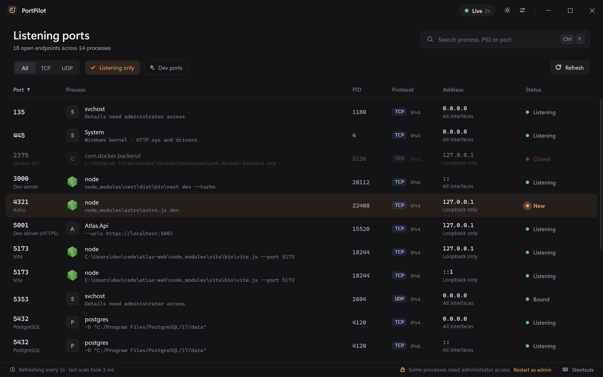
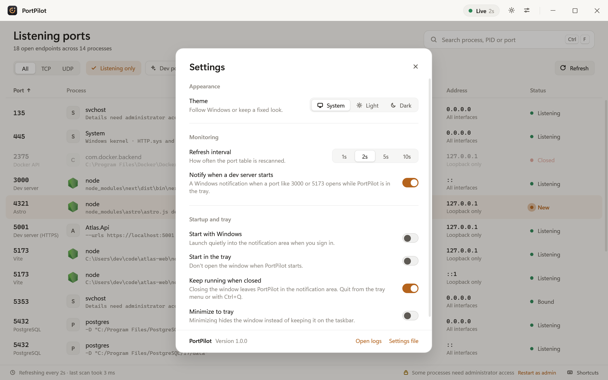

<p align="center">
  
</p>

<h1 align="center">PortPilot</h1>

<p align="center">
  <b>Something is already running on port 3000.</b><br/>
  It has always been running on port 3000. PortPilot tells you what it is, and lets you end it with dignity.
</p>

<p align="center">
  
  
  
  
  
</p>

<p align="center">
  
</p>

---

## The problem

```text
Error: listen EADDRINUSE: address already in use :::3000
```

You did not start anything on port 3000. You are almost sure of this. You run `netstat -ano | findstr :3000`, which returns a PID and no explanation. You open Task Manager, which has 214 processes, 31 of which are called `node`. You pick one. It was Slack.

PortPilot is the window you open instead.

## What it does

PortPilot is a small native Windows app that watches every listening port on your machine and tells you, in plain language, who is responsible.

- **Every listening port, live.** TCP and UDP, IPv4 and IPv6, refreshed every two seconds. A full scan takes about 3 ms, which is less time than you have spent reading this sentence.
- **The actual culprit.** Process name, PID, real app icon, executable path, the full command line (so `node` becomes `vite --port 5173`), when it started, and who published it.
- **Knows your ports.** 3000, 5173, 8000, 8080, 5432, 6379 and about thirty others are labelled *Vite*, *PostgreSQL*, *Redis* and so on. One click hides everything else.
- **Notices change.** A server that just started glows briefly and says *New*. One that just died turns grey and says *Closed*, then quietly leaves. Your browser opens and closes a throwaway UDP socket every second or two; PortPilot has decided not to make that your problem.
- **Actions, with a seatbelt.** Open `localhost:5173` in your browser, copy details, show the executable in File Explorer, or terminate the process. Terminating asks first, and checks the PID still belongs to the same process before doing anything. It will not kill the System process, itself, or anything Windows considers critical, however politely you ask.
- **Honest about permissions.** Windows keeps some processes private unless you are an administrator. PortPilot says *Details need administrator access* rather than pretending they don't exist, and offers to restart elevated.
- **Lives in the tray.** Close the window and it keeps watching. Optionally it will tell you when a dev server starts, in case you forgot you started it.

<table>
  <tr>
    <td width="50%"></td>
    <td width="50%"></td>
  </tr>
  <tr>
    <td align="center"><sub>Click a row. Learn everything. Regret nothing.</sub></td>
    <td align="center"><sub>It asks first. Most tools don't.</sub></td>
  </tr>
  <tr>
    <td width="50%"></td>
    <td width="50%"></td>
  </tr>
  <tr>
    <td align="center"><sub>Settings apply immediately. There is no Save button to forget.</sub></td>
    <td align="center"><sub>Even the empty states were designed. Someone had to.</sub></td>
  </tr>
</table>

## Install

**Build it** (about two minutes, most of which is the installer compressing itself):

```powershell
git clone https://github.com/Atrix21/port-pilot.git
cd port-pilot
./build.ps1
```

This runs the tests and produces two files:

| File | What it is |
| --- | --- |
| `artifacts/installer/PortPilot-1.0.0-Setup.exe` | The installer (~44 MB). Per-user, no admin prompt. |
| `artifacts/publish/PortPilot.exe` | The app as a single self-contained file (~140 MB). Runs anywhere, installs nothing. |

You need the [.NET 10 SDK](https://dotnet.microsoft.com/download/dotnet/10.0) to build, and [Inno Setup 6](https://jrsoftware.org/isinfo.php) for the installer (`winget install JRSoftware.InnoSetup`). The finished app needs neither. It doesn't even need .NET.

Want to look around first? `PortPilot.exe --demo` runs it against a pretend developer machine, so you can click *Terminate* on things without consequences, which is more than can be said for real life.

## Using it

Start typing anywhere and it searches. Names, PIDs, ports, addresses and port labels all match, so `vite`, `postgres`, `5173` and `18244` all work. Prefix with `:` to match ports only (`:30`) or `pid:` for process IDs.

Click a row for the inspector, hover a row for quick actions, right-click for all of them. Double-click opens it in the browser.

<details>
<summary><b>Keyboard shortcuts</b> (there are a lot; the mouse is optional)</summary>
<br/>

| Shortcut | Does |
| --- | --- |
| `Ctrl F`, or just type | Search |
| `Esc` | Clear search, close the inspector or a dialog |
| `Ctrl 1` / `2` / `3` | All / TCP only / UDP only |
| `Ctrl L` | Listening only, or every connection |
| `Ctrl D` | Dev ports only |
| `F5` | Scan now |
| `Ctrl P` | Pause or resume live updates |
| `Ctrl Enter` | Open the selected port in your browser |
| `Ctrl C` / `Ctrl Shift C` | Copy details / copy URL |
| `Ctrl E` | Show the executable in File Explorer |
| `Del` | Terminate (it asks first) |
| `Ctrl ,` | Settings |
| `Ctrl T` | Switch light / dark |
| `Ctrl /` | Show all of this, in the app |
| `Ctrl Q` | Actually quit (closing the window keeps it in the tray) |

</details>

<details>
<summary><b>Where it keeps things</b></summary>
<br/>

| What | Where |
| --- | --- |
| Settings | `%APPDATA%\PortPilot\settings.json` |
| Logs (structured JSON lines, kept 7 days) | `%LOCALAPPDATA%\PortPilot\logs` |

Command-line flags: `--minimized`, `--demo`, `--verbose`, `--screenshot <folder>`. That last one renders every screenshot in this README, which is how they all line up so suspiciously well.

</details>

## Frequently anticipated questions

**Is this just `netstat` with a nicer font?**
Yes, in the sense that a car is wheels with a nicer chair. It reads the same Windows tables `netstat` does, then also tells you the command line, the start time, the publisher, whether you can kill it, and whether that PID now belongs to a different program than it did a moment ago.

**Why not Electron?**
It watches ports on your machine. Making it also occupy several of them seemed rude.

**Does it phone home?**
It does not have a home. No telemetry, no accounts, no network calls. It reads your port table and writes a settings file. That is the whole relationship.

**Why does it need administrator rights?**
It doesn't. Windows just won't show anyone the details of system processes without them. PortPilot runs as you, shows what you are allowed to see, and offers to restart elevated when you need more.

**It says a port is owned by "System". What is System?**
Usually HTTP.sys, the part of Windows that serves ports on behalf of IIS, WinRM and other services. PortPilot will not terminate it. Neither should you.

**Will it accidentally kill the wrong process?**
Before terminating, it checks the PID still belongs to a process with the same start time as the one you selected. If Windows has recycled the PID in the meantime, it stops and tells you. This is the kind of thing nobody notices until it happens, and then it is all anyone talks about.

## How it's built

```text
src/PortPilot.Core          The engine. No UI. Port tables, process inspection, termination,
                            change tracking, filtering, settings, logging.
src/PortPilot.App           The WPF app. MVVM, a hand-built design system, Windows integration.
tests/PortPilot.Core.Tests  41 tests. They open real sockets and kill real (consenting) processes.
tools/PortPilot.IconGen     Draws the app icon in code, because the icon is also code.
installer/PortPilot.iss     The Inno Setup script.
```

<details>
<summary><b>The details, for people who read the details</b></summary>
<br/>

- **Discovery** calls `GetExtendedTcpTable` and `GetExtendedUdpTable` directly. Process details come from `QueryFullProcessImageName`, `GetProcessTimes` and `NtQueryInformationProcess` (for the command line). A cache keyed on PID *and* start time means steady-state scans only touch processes that are new.
- **Monitoring** runs on a background loop that never overlaps scans, and slows to every 5 seconds or more while the window is hidden. Snapshots are diffed, and long-lived row view models are updated in place, so the list never rebuilds and never flickers.
- **The design system** is in `src/PortPilot.App/Themes`. It has colour tokens for both themes, a type scale (Segoe UI Variable for text, Cascadia Mono for numbers, tabular figures throughout), a 24-unit icon set drawn at a constant 1.5 px stroke, and every control restyled from scratch. Theme changes cross-fade.
- **Windows integration** covers:
  - a custom title bar that still gives you Snap Layouts
  - rounded corners and a theme-matched window border
  - per-monitor DPI, and window placement that is only restored if it's still on a screen
  - a native tray icon that survives Explorer restarting
  - a single instance, start with Windows, and UAC elevation
- **Dependencies:** `Microsoft.Extensions.Logging.Abstractions`. That's the list.

On a machine with about 60 open endpoints, a scan takes 1–3 ms. The Release build uses about 3–4% of one CPU core while the window is open and under 1% from the tray.

</details>

## Contributing

Issues and pull requests are welcome. Run `./build.ps1` before sending anything; it runs the tests, and the tests have opinions.

## License

[MIT](LICENSE). Do what you like. If it terminates something important, it asked first.
