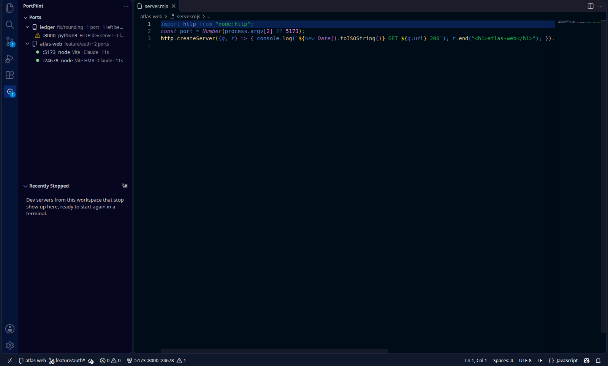
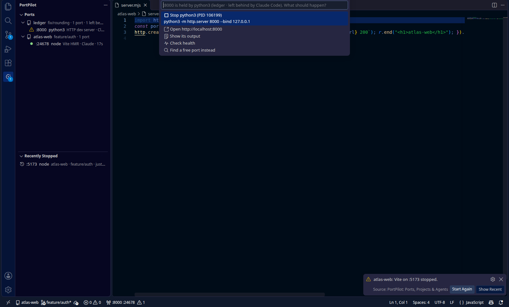

# PortPilot for VS Code

**What is running on your ports, which project and coding agent it belongs to, and what was left behind.** No setup, no app registry: PortPilot sees every dev server already running and works out the rest.

## What it does

- **Every port, grouped by project.** Each process's working folder is matched to its git repository, branch and worktree, so ports show up under *atlas-web · feature/auth* rather than as a wall of PIDs. Editors, language servers and build daemons are hidden unless you ask for them.
- **Knows which agent started what.** A server started by Claude Code, Codex, Gemini CLI, Aider, Cursor Agent or opencode, through any shell command, is tagged with that agent. No special launcher needed.
- **Finds what an agent left behind.** When a session ends but its dev server keeps the port, the row says *left behind*. **Clean up** stops all of them, for one project or every project.
- **Tells you when a server stops, and starts it again.** If a dev server in this workspace goes down, you get a toast with **Start Again**. It reruns the same command from the same folder in a terminal. Stopped servers stay in **Recently Stopped**.
- **`EADDRINUSE`, answered where you see it.** "address already in use :3000" in the terminal becomes a link to who holds the port, with stop, open, output, health, and *find a free port instead*.

- **Per port:** open in browser, show output (from a redirected log file or the systemd journal), check health (HTTP status and latency), copy the URL or PID, and stop it (it asks first). Each row shows the runtime (Node.js, Python, Go, Java, database, Docker, …) and how long it has been up.
- **Status bar:** this workspace's ports, plus a warning count for anything left behind.
- **For agents too.** PortPilot's MCP server is offered to agents in VS Code (e.g. Copilot agent mode). *PortPilot: Set Up Claude Code Integration* adds a session-end hook, a guard that stops Claude starting a second copy of a dev server that is already running, a status line, and the MCP server.

## Light by design

There is no runtime to install and no background service. The extension calls a small native engine (bundled for your platform, about 3 MB) that reads the OS's socket tables directly, in about a millisecond. It scans only while the window is focused, every few seconds.

## Settings

| Setting | Default | |
| --- | --- | --- |
| `portpilot.scope` | `workspace` | `all` shows every listening port on the machine. |
| `portpilot.notifyOnStop` | `true` | Toast with Start Again when a workspace dev server stops. |
| `portpilot.notifyOnStart` | `false` | Toast when a new server starts listening in the workspace. |
| `portpilot.showTooling` | `false` | Show editors, language servers and build daemons. |
| `portpilot.ignorePorts` | `[]` | Ports never to show. |
| `portpilot.hideSystemPorts` | `true` | With `scope: all`, hide ports below 1024. |
| `portpilot.refreshSeconds` | `3` | |
| `portpilot.statusBar` | `true` | |
| `portpilot.registerMcpServer` | `true` | |
| `portpilot.cliPath` | | Use a specific `portpilot` binary. |

PortPilot is also a desktop app (Windows, macOS, Linux), a terminal app, and a JetBrains plugin: [github.com/Atrix21/port-pilot](https://github.com/Atrix21/port-pilot).
